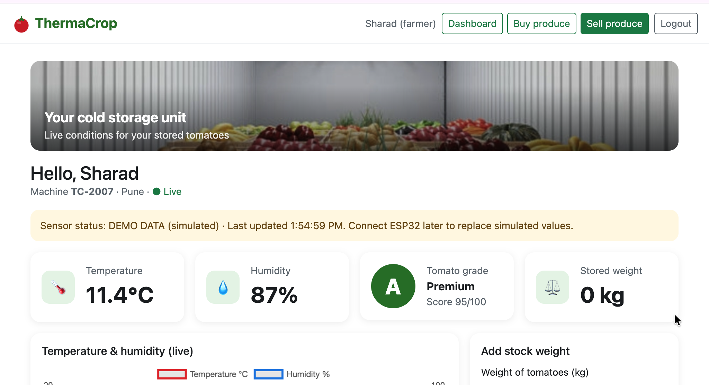
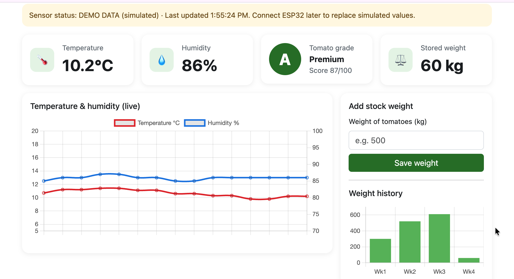
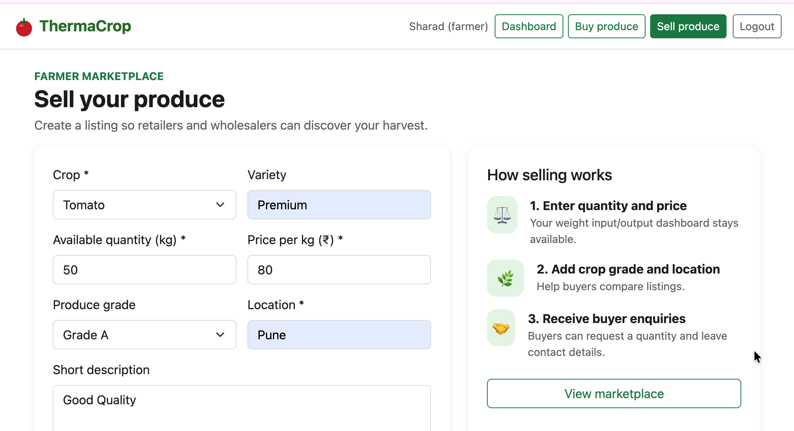
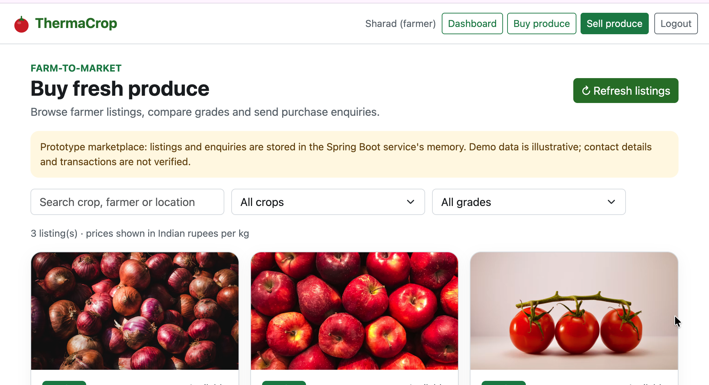
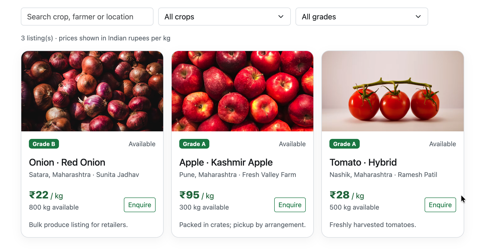
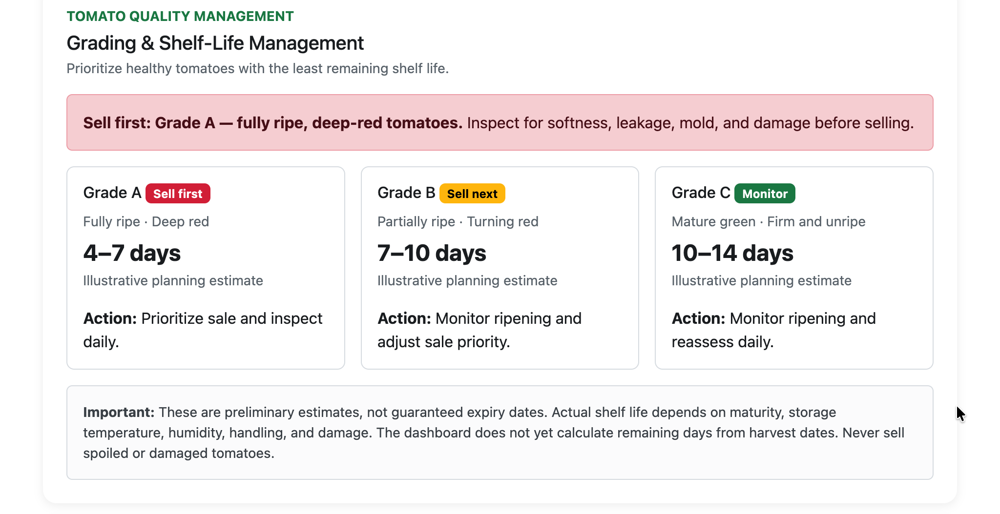

# ThermaCrop 🌱
### Smart Agricultural Cold Storage & Produce Marketplace

ThermaCrop is a web-based agricultural technology prototype designed to support cold-storage monitoring, produce sorting records, and direct connections between farmers and buyers.

The project combines a web dashboard with a Java Spring Boot REST API. It currently supports simulated sensor readings, marketplace listings, buyer enquiries, and produce-sorting event tracking. The sensor API also accepts readings from an ESP32 for future or ongoing hardware integration.

---

## 📌 Project Overview

Farmers need better ways to monitor storage conditions, manage produce, and connect with potential buyers. ThermaCrop explores how web technologies and IoT integration can help bring these activities into one platform.

### Key Features

- **Cold-Storage Monitoring:** View the latest temperature and humidity readings and their recent history.
- **Sensor REST API:** Accept temperature and humidity readings from external devices, including an ESP32.
- **Produce Sorting:** Record sorting events by grade, confidence score, and sorting status.
- **Sorting Summary:** Retrieve counts of successfully sorted Grade A, B, and C produce.
- **Produce Marketplace:** View available listings, including crop, variety, quantity, price, grade, and location.
- **Buyer Enquiries:** Submit enquiries against produce listings and retrieve recorded enquiries.
- **Web Dashboard:** Browser-based interface for the prototype's monitoring and marketplace features.

---

## 🛠️ Technology Stack

| Component | Technology |
|---|---|
| Frontend | HTML, CSS, JavaScript |
| UI and Charts | Bootstrap, jQuery, Chart.js (as used by the existing prototype) |
| Backend | Java 21, Spring Boot 3.5.6 |
| API | REST, JSON |
| Build Tool | Maven |
| Hardware Integration Path | ESP32 |
| Current Data Storage | In-memory Java collections |

---

## 🏗️ System Architecture

```text
┌─────────────────────────────────────┐
│          Web Dashboard              │
│       HTML / CSS / JavaScript       │
└─────────────────┬───────────────────┘
                  │ HTTP / JSON
                  ▼
┌─────────────────────────────────────┐
│       Java Spring Boot Backend      │
│                                     │
│  Sensor API  │ Marketplace API      │
│  Sorting API │ Enquiry API          │
└─────────────────┬───────────────────┘
                  │
                  ▼
┌─────────────────────────────────────┐
│       In-Memory Application Data    │
│ Sensor History / Listings / Events  │
└─────────────────────────────────────┘
                  ▲
                  │ HTTP POST
            ┌─────┴─────┐
            │  ESP32    │
            │ Integration│
            └───────────┘
```

**Note:** The diagram represents the application's logical architecture. Persistent database storage is not currently implemented in this version.

---

## ⚙️ Getting Started

### Prerequisites

Install or configure the following:

- Java Development Kit (JDK) 21
- Apache Maven
- A modern web browser
- Visual Studio Code Live Server (recommended for the frontend)

Verify Java and Maven:

```bash
java -version
mvn -version
```

### 1. Clone the Repository

```bash
git clone https://github.com/Ankita-babar/ThermaCrop.git
cd ThermaCrop
```

### 2. Start the Spring Boot Backend

Open a terminal:

```bash
cd backend
mvn spring-boot:run
```

The backend starts at:

`http://localhost:8080`

Keep this terminal running.

### 3. Open the Frontend

Open a second terminal from the project root:

```bash
cd frontend
python3 -m http.server 5500
```

Open the following address in your browser:

`http://localhost:5500`

The backend allows requests from the local development origins configured in its controllers, including port 5500.

### 4. Test the Backend

Check the latest sensor reading:

```bash
curl http://localhost:8080/api/sensors/latest
```

Retrieve marketplace listings:

```bash
curl http://localhost:8080/api/market/listings
```

Retrieve sorting statistics:

```bash
curl http://localhost:8080/api/sorting/summary
```

---

## 🔌 REST API Documentation

Base URL:

`http://localhost:8080`

### Sensor APIs

| Method | Endpoint | Description |
|---|---|---|
| GET | `/api/sensors/latest` | Retrieve the latest reading |
| GET | `/api/sensors/history` | Retrieve recent readings |
| POST | `/api/sensors` | Submit a sensor reading |

Example request for `POST /api/sensors`:

```json
{
  "temperature": 12.4,
  "humidity": 86.0
}
```

Temperature must be between -40 and 80 °C, and humidity must be between 0 and 100%.

The current dummy sensor generator is enabled by default and generates readings every five seconds. It can be disabled through the backend configuration when testing real sensor input.

### Marketplace APIs

| Method | Endpoint | Description |
|---|---|---|
| GET | `/api/market/listings` | Retrieve produce listings |
| POST | `/api/market/listings` | Create a produce listing |
| POST | `/api/market/enquiries` | Submit a buyer enquiry |
| GET | `/api/market/enquiries` | Retrieve buyer enquiries |

Example request for `POST /api/market/listings`:

```json
{
  "crop": "Tomato",
  "variety": "Hybrid",
  "quantityKg": 500,
  "pricePerKg": 28,
  "grade": "Grade A",
  "location": "Nashik, Maharashtra",
  "sellerName": "Demo Farmer",
  "description": "Freshly harvested tomatoes.",
  "imageUrl": ""
}
```

Example request for `POST /api/market/enquiries`:

```json
{
  "listingId": 1001,
  "buyerName": "Demo Buyer",
  "contact": "buyer@example.com",
  "quantityKg": 10,
  "message": "Please share availability details."
}
```

Use an actual listing ID returned by the listings API when submitting an enquiry.

### Sorting APIs

| Method | Endpoint | Description |
|---|---|---|
| POST | `/api/sorting/events` | Record a sorting event |
| GET | `/api/sorting/events` | Retrieve sorting events |
| GET | `/api/sorting/summary` | Retrieve grade-wise sorting totals |

Example request for `POST /api/sorting/events`:

```json
{
  "grade": "A",
  "confidence": 96.5,
  "sortingStatus": "SORTED"
}
```

Accepted grades are `A`, `B`, and `C`. Accepted sorting statuses are `SORTED` and `FAILED`. Confidence must be between 0 and 100.

---

## 🔬 Hardware Integration

The sensor API provides an integration point for an ESP32-based temperature and humidity monitoring system.

To submit a reading from an ESP32:

1. Connect the appropriate sensor to the ESP32.
2. Configure the ESP32 firmware to read the sensor values.
3. Send an HTTP POST request with a JSON payload to `/api/sensors`.
4. Use the Mac's reachable local network IP address instead of `localhost` when sending requests from another device.
5. Disable dummy sensor generation when testing real readings to prevent simulated data from replacing the latest values.

The backend currently enables dummy readings by default:

```properties
thermacrop.sensor.dummy.enabled=true
thermacrop.sensor.dummy.interval-ms=5000
```

For real-sensor testing, set the first property to `false` and restart the backend.

Do not expose the development API to the public internet without suitable authentication, access controls, and HTTPS.

---

## ⚠️ Current Limitations

- **In-memory storage:** Sensor history, sorting events, marketplace listings, and enquiries are not persisted to a database. Data resets when the backend restarts.
- **Simulated sensor feed:** Dummy readings are enabled by default; live hardware readings require the ESP32 to be configured and connected.
- **Prototype authentication:** Login and registration remain browser-side demo functionality, not secure backend authentication.
- **Sorting classification:** Sorting event recording and summary APIs are implemented, but these APIs alone do not provide a validated AI-based crop grading model.
- **Development configuration:** The backend is configured for specific local frontend origins. Production deployment requires appropriate CORS, authentication, and security settings.

---

## 🚀 Future Improvements

- Integrate persistent storage using MySQL or PostgreSQL.
- Connect ESP32 hardware for continuous temperature and humidity monitoring.
- Add authenticated farmer and buyer accounts with backend authorization.
- Integrate validated computer-vision-based produce grading.
- Add persistent sorting reports and historical analytics.
- Deploy the frontend and backend with secure production configurations.

---

## 👩‍💻 Author

**Ankita Babar**

GitHub: [Ankita-babar](https://github.com/Ankita-babar)

Project Repository: [ThermaCrop](https://github.com/Ankita-babar/ThermaCrop)

---

*ThermaCrop is an agricultural technology prototype developed to explore cold-storage monitoring, produce sorting records, marketplace workflows, and IoT integration.*

## Project Screenshots

### Screenshot 1


### Screenshot 2


### Screenshot 3


### Screenshot 4


### Screenshot 5


### Screenshot 6

